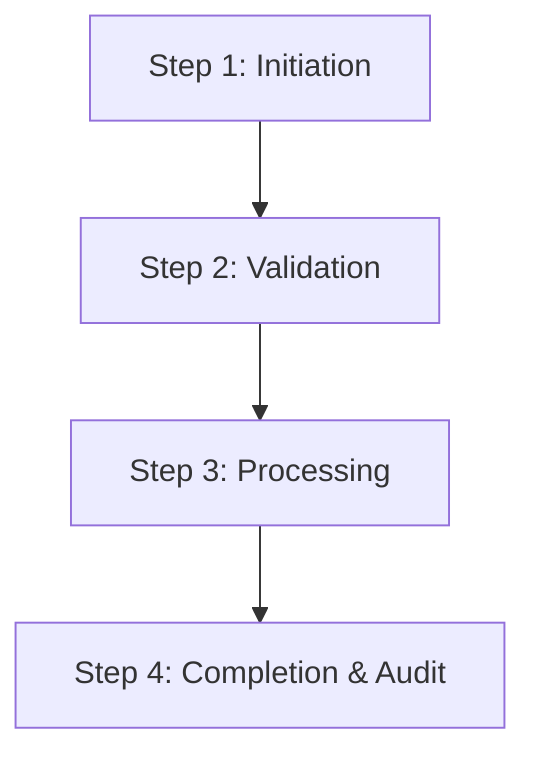

# Standard Operating Procedure (SOP)

## SOP Metadata
- **SOP Code:** {{sop_code}}
- **Process Title:** {{process_title}}
- **Effective Date:** {{effective_date}}
- **Governing Body / Department:** {{department}}
- **Target Audience / Roles:** {{target_roles}}

---

## 1. Purpose & Scope
Define the exact objective of this Standard Operating Procedure, operational boundaries, and statutory alignment.

## 2. Prerequisites & Pre-Execution Checklist
- System access & role authorizations required
- Minimum account balance / EMD / credential requirements
- Pre-trade / Pre-flight environmental checks

## 3. Step-by-Step Execution Lifecycle

### Phase 1: Entry & Ingestion
1. Initial receipt, verification of identifiers, and timestamp recording.
2. Quality parameter verification and weighment logging.

### Phase 2: Core Processing & Auction / Settlement
1. Automated bidding window execution or transaction dispatch.
2. Real-time pricing validation and lock mechanisms.

### Phase 3: Post-Execution Confirmation & Dispatch
1. E-Permit / Invoicing / Gate Pass generation.
2. Direct Benefit Transfer (DBT) or payment settlement trigger.

## 4. Exception Handling & Troubleshooting
| Failure Scenario / Error Code | Root Cause | Immediate Remediation Step | Escalation SLA |
| :--- | :--- | :--- | :--- |
| `ERR_AUTH_EXPIRED` | Session timeout | Re-authenticate via SSO token | Instant |
| `ERR_PAYMENT_TIMEOUT` | Bank gateway lag | Check escrow status, do not re-debit | 15 Minutes |
| `ERR_LOT_NOT_FOUND` | Unsynchronized mandi database | Trigger CDC sync job | 5 Minutes |

## 5. Compliance, Audit Trail & Record Retention
- Log retention policy (minimum 7 years).
- Statutory compliance under APMC Act and Financial Regulations.
