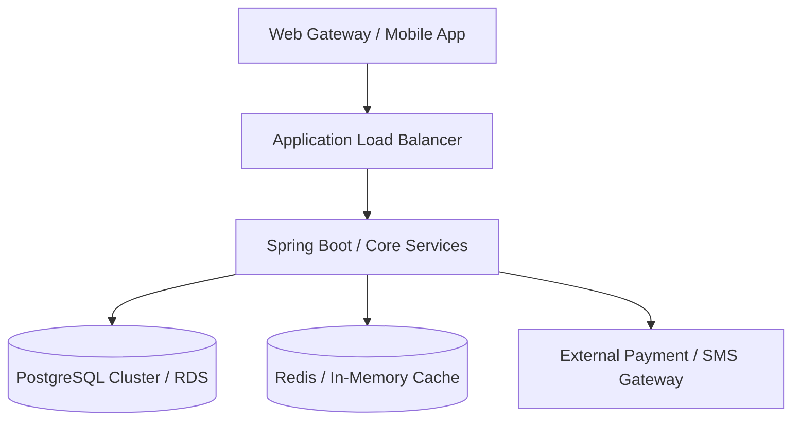

# Enterprise Technical Architecture & System Specification

## 1. System Overview & Architectural Objectives
- **System / Microservice Name:** {{system_name}}
- **Current Version:** {{system_version}}
- **Domain:** {{domain}}

## 2. Component Architecture & Technology Stack

## 3. Data Model, Schemas & API Endpoints
### Primary Data Entities
- Description of core relational tables and schema models.

### Key API Contracts
| HTTP Method | Route / Endpoint | Description | Expected Response |
| :--- | :--- | :--- | :--- |
| `GET` | `/actuator/health` | Service health telemetry | `{"status": "UP"}` |
| `POST` | `/api/v1/trade/bid` | Place auction bid | `{"bidId": "...", "status": "ACCEPTED"}` |
| `POST` | `/api/v1/settle` | Trigger clearing & payment | `{"txId": "...", "amount": "..."}` |

## 4. Non-Functional Requirements (NFRs) & Latency SLAs
- **p95 Latency SLA:** < 250ms for auction price updates.
- **Availability Target:** 99.95% during trading hours (08:00 to 18:00 IST).
- **Concurrency Target:** 10,000 active concurrent trader sessions.

## 5. Security, Disaster Recovery & Failover Protocol
- Zero-trust network segmentation.
- Automated multi-AZ database failover in < 30 seconds.
